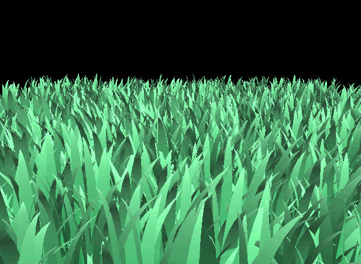
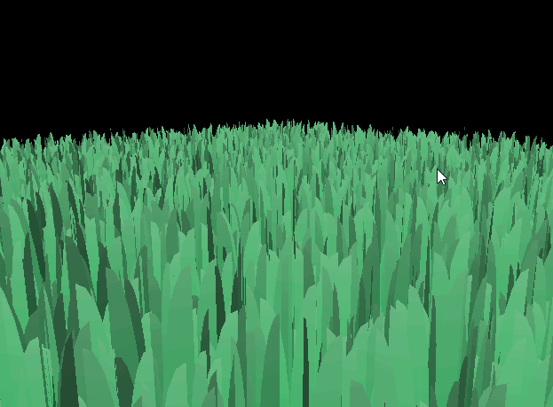
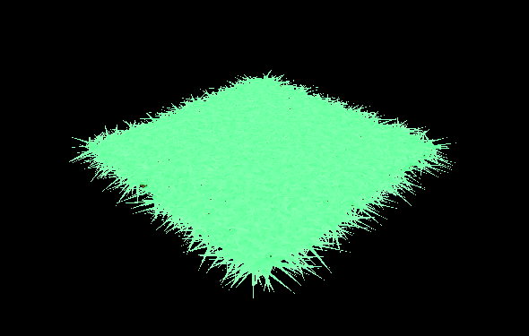
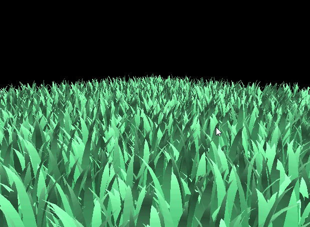
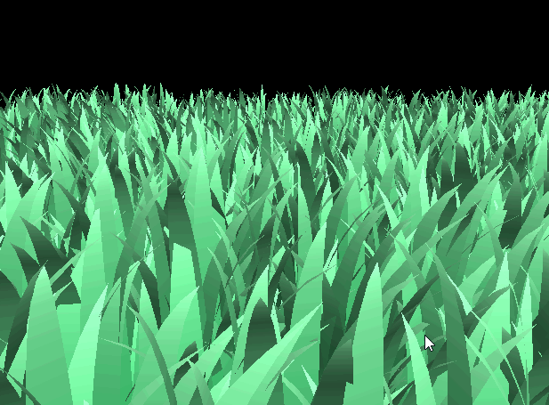
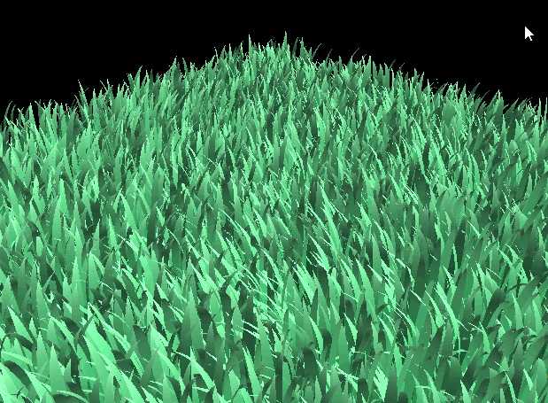
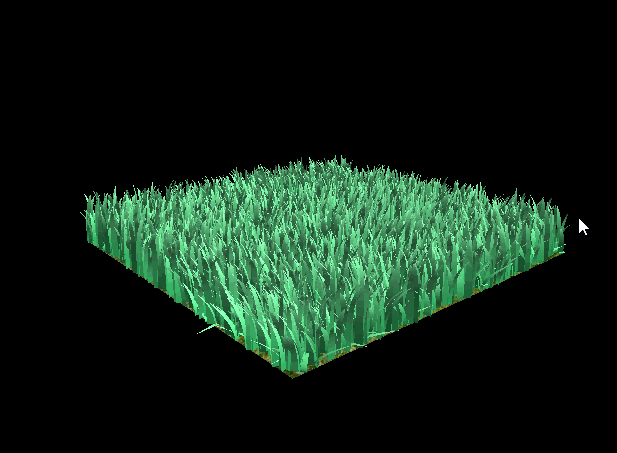
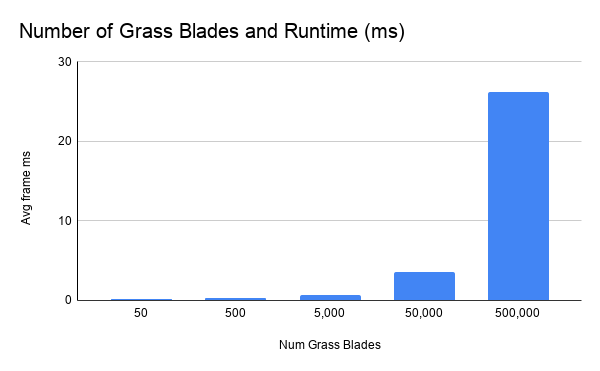
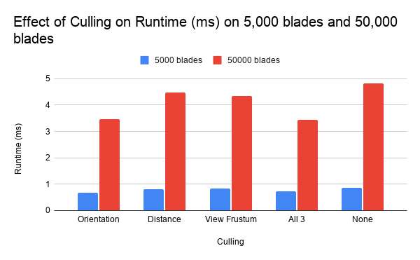

Vulkan Grass Rendering
==================================

**University of Pennsylvania, CIS 565: GPU Programming and Architecture, Project 5**

* Alice Liu
  * [LinkedIn](https://www.linkedin.com/in/aliceliuu/), [personal website](https://aliceliu.xyz/)
* Tested on: Windows 11, AMD Ryzen 5 7640HS @ 4.30GHz 16GB, RTX 4060 Laptop GPU 8GB (Personal Laptop)

## Overview

   
  8192 blades of grass

In this project, I used Vulkan to implement a grass simulator and renderer, following the paper [Responsive Real-Time Grass Rendering for General 3D Scenes](https://www.cg.tuwien.ac.at/research/publications/2017/JAHRMANN-2017-RRTG/JAHRMANN-2017-RRTG-draft.pdf). The project was split into three main parts that are explained more in depth below:
- Rendering the blades of grass
- Applying forces (gravity, recovery, and wind)
- Culling

### Rendering

   
  Still grass before forces are applied

In this implementation, grass blades are as Bezier curves with 3 control points:
- `v0`: the position of the bottom or"root" of the blade
- `v1`: Bezier control point (always above v0)
- `v2`: physical guide for force simulation

These points are stored along with data like the up vector, and orientation, height, width, stiffness (all as w terms of the previous vectors) of the blade. 

   

In order to get the blades of grass to render on the scene, each blade goes through four shaders:
- Vertex Shader (`grass.vert`): reads attributes from vertex buffer and forwards it
- Tesselation Control Shader (`grass.tesc`): determines the LOD/level of tesselation
- Tesselation Evaluation Shader (`grass.tese`): evaluates De Casteljau's to output positions for each vertex of the grass blade
- Fragment Shader (`grass.frag`): calculates grass color (gradient) and simple lighting

Of the grass blade shapes, I implemented the quaternion grass shape.

### Forces
| Gravity | Gravity + Recovery | Gravity + Recovery + Wind |
|---|---|---|
|  |  |  | 

To make the grass look more natural, we apply forces of gravity, recovery, and wind. Gravity is composed of environmental gravity and front gravity, to make grass to bend with respect to its front direction. Recovery is used to bring the grass blades to equilibrium based on it's stiffness. Wind is composed of wind direction and wind alignment. The wind direction in my implementation is calculated using both a sin and cos function. 

### Culling
| Distance Culling | View-Frustum Culling (exaggerated for viewing purposes) |
|---|---|
|  |  | 

In order to improve performance, we cull blades using 3 different heuristics. This works because we are choosing to cull blades that will likely not contribute much to the scene. 

The first is orientation culling (not shown above), where we cull blades of grass that are perpendicular/near-perpendicular to the camera. Since our grass has no thickness, many parts of these blades are smaller than the size of a pixel which can cause artifacts and they generally do not contribute much to the scene. 

The second is distance culling, where we cull blades based on how far they are from the camera. We set a max distance where all grass blades farther than that are culled, and sort all the other blades into buckets based on distance, and cull more grass depending on which bucket it falls into. 

The third is view-frustum culling, where we cull blades of grass that are not within view-frustum of the camera, as they will not be in the frame. We do this by looking at the visibility of 3 points of each blade of grass, v0, v2, and m (calculated as a function of v0, v1, and v2). 

## Performance Analysis

### Number of Grass Blades

   

From the graph, we can see that as the number of grass blades increases, the runtime also increases. It does not increase linearly, as the scaling rate increases with blade count.

Below is the raw data:

| Number of Grass Blades | Avg Frame Time (ms) |
| :---: | :---: |
| 50 | 0.201 ms |
| 500 | 0.318 ms |
| 5,000 | 0.719 ms |
| 50,000 | 3.578 ms |
| 500,000 | 26.270 ms |

### Culling Tests

   

From the graph, we can see that orientation culling was the best individually for performance, followed by view-frustum and distance. However, this will likely depend on the scene, and how far/close the camera is and the direction it is pointed. Running all 3 culling tests did improve performance overall, and was better than no culling, which consistently did the worst. 

Below is the raw data:
| Number of Grass Blades | Orientation (ms) | Distance (ms) | View Frustum (ms) | All 3 (ms) | None (ms) |
| :---: | :---: | :---: | :---: | :---: | :---: |
| 5,000 blades | 0.678 | 0.819 | 0.825 | 0.722 | 0.856 |
| 50,000 blades | 3.461 | 4.465 | 4.345 | 3.436 | 4.811 |